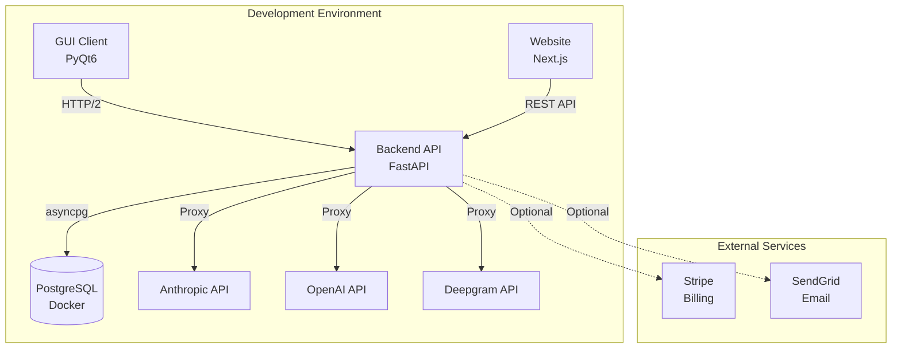

# GlassNote Local Development Setup Plan

## Overview

This plan outlines the complete setup process for the GlassNote development environment on Windows. The system consists of three main components:

1. **Backend** - FastAPI server with PostgreSQL database
2. **GUI** - PyQt6 desktop application for Windows
3. **Website** - Next.js marketing site and dashboard

## Architecture



## Prerequisites Checklist

### Required Software

- [x] Python 3.12+ (already installed)
- [ ] Node.js 20+ and npm
- [ ] Docker Desktop (for PostgreSQL)
- [x] Git (assumed installed)

### Optional API Keys

- [ ] Anthropic API Key (required for GUI functionality)
- [ ] OpenAI API Key (for Whisper STT and GPT models)
- [ ] Deepgram API Key (alternative STT provider)
- [ ] Stripe Keys (for billing features)
- [ ] SendGrid API Key (for email notifications)
- [ ] Google OAuth credentials (for social login)

## Setup Steps

### Phase 1: System Prerequisites

#### 1.1 Verify Python Installation
```bash
python --version
```
Expected: Python 3.12.x or higher

#### 1.2 Install Node.js
- Download Node.js 20 LTS from nodejs.org
- Run installer with default settings
- Verify installation:
  ```bash
  node --version
  npm --version
  ```

#### 1.3 Install Docker Desktop
- Download from docker.com
- Install and start Docker Desktop
- Verify installation:
  ```bash
  docker --version
  docker compose version
  ```

### Phase 2: Backend Setup

#### 2.1 Create Environment Configuration
```bash
cd backend
copy .env.example .env
```

Edit `.env` file with your configuration:
- Set `DATABASE_URL` (default works for Docker setup)
- Set `JWT_SECRET` (generate with: `openssl rand -hex 32`)
- Add `ANTHROPIC_API_KEY` (required)
- Add `OPENAI_API_KEY` (optional)
- Configure other optional services as needed

#### 2.2 Start PostgreSQL Database
```bash
docker compose up -d
```

This creates:
- PostgreSQL 16 container
- Database: `glassnote`
- User: `glassnote`
- Password: `glassnote`
- Port: 5432
- Persistent volume for data

Verify:
```bash
docker compose ps
```

#### 2.3 Install Python Dependencies
```bash
pip install -r requirements.txt
```

Installs:
- FastAPI & Uvicorn (web framework)
- SQLAlchemy & asyncpg (database ORM)
- Alembic (database migrations)
- python-jose & bcrypt (authentication)
- httpx (HTTP/2 client for proxying)
- stripe (billing)
- sendgrid (email)
- slowapi (rate limiting)

#### 2.4 Run Database Migrations
```bash
alembic upgrade head
```

Creates tables:
- `users` - User accounts with plan info
- `sessions` - Interview sessions
- `api_calls` - API usage tracking
- `usage_quotas` - Monthly usage limits
- `email_otps` - Email verification codes
- `system_notifications` - Admin broadcasts

#### 2.5 Start Backend Server
```bash
uvicorn app.main:app --reload --port 8000
```

Verify:
- API root: http://localhost:8000
- API docs: http://localhost:8000/docs
- Health check: http://localhost:8000/health

### Phase 3: GUI Setup

#### 3.1 Install GUI Dependencies
```bash
cd GUI
pip install -r requirements.txt
```

Installs:
- PyQt6 (UI framework)
- mss & Pillow (screen capture)
- anthropic & openai (LLM clients)
- httpx (HTTP/2 client)
- sounddevice, numpy, scipy (audio recording)
- deepgram-sdk & websockets (STT)
- keyboard (global hotkeys)
- PyMuPDF & python-docx (resume parsing)
- pywin32 (Windows APIs for invisibility)
- pyinstaller (for building .exe)

#### 3.2 Configure API Keys
On first run, the app will create a config file. You can also configure manually:

Create `GUI/config.json`:
```json
{
  "api_keys": {
    "anthropic": "sk-ant-your-key-here",
    "openai": "sk-your-key-here"
  },
  "backend_url": "http://localhost:8000"
}
```

Or configure via GUI:
1. Run: `python main.py`
2. Right-click tray icon → Settings → API Keys
3. Enter your keys and save

#### 3.3 Test GUI Application
```bash
python main.py
```

The app runs as a system tray icon only (no window). Look for the icon in the bottom-right corner.

### Phase 4: Website Setup

#### 4.1 Install Node Dependencies
```bash
cd website
npm install
```

Installs:
- Next.js 15 (React framework)
- React 19 (UI library)
- Tailwind CSS 4 (styling)
- TypeScript (type safety)
- Lucide React (icons)
- ESLint (linting)

#### 4.2 Start Development Server
```bash
npm run dev
```

Verify:
- Website: http://localhost:3000
- Should see GlassNote landing page

### Phase 5: Documentation & Testing

#### 5.1 Create Setup Documentation
- [x] Main setup guide (SETUP.md)
- [x] Environment template (.env.example)
- [x] This setup plan

#### 5.2 Test All Components

**Backend:**
- [ ] Server starts without errors
- [ ] Database connection successful
- [ ] API docs accessible
- [ ] Health check returns OK

**GUI:**
- [ ] Application starts
- [ ] Tray icon visible
- [ ] Settings panel opens
- [ ] API keys can be configured

**Website:**
- [ ] Development server starts
- [ ] Homepage loads
- [ ] No console errors
- [ ] Hot reload works

#### 5.3 Create Quick Start Guide
Document daily development workflow:
1. Start Docker Desktop
2. Start backend server
3. Start GUI (optional)
4. Start website (optional)

## Configuration Details

### Backend Environment Variables

#### Core Configuration
- `DATABASE_URL` - PostgreSQL connection string
- `JWT_SECRET` - Secret for signing JWT tokens
- `DEBUG` - Enable debug mode (true for development)

#### API Keys
- `ANTHROPIC_API_KEY` - Required for Claude models
- `OPENAI_API_KEY` - Required for GPT and Whisper
- `DEEPGRAM_API_KEY` - Optional alternative STT

#### Optional Services
- `STRIPE_SECRET_KEY` - For payment processing
- `STRIPE_WEBHOOK_SECRET` - For Stripe webhooks
- `SENDGRID_API_KEY` - For email notifications
- `GOOGLE_CLIENT_ID` - For Google OAuth
- `GOOGLE_CLIENT_SECRET` - For Google OAuth
- `ADMIN_SECRET` - For admin endpoints

#### Server Configuration
- `CORS_ORIGINS` - Allowed CORS origins (comma-separated)
- `RATE_LIMIT_PER_MINUTE` - API rate limit per user
- `SESSION_PRICE_CENTS` - Per-session price for PAYG

### GUI Configuration

Stored in `GUI/config.json`:
- API keys (Anthropic, OpenAI)
- Backend URL
- Model preferences
- Overlay settings
- Audio settings
- Hotkey bindings

### Database Schema

**users table:**
- User accounts with authentication
- Plan subscription info
- Device binding for license enforcement
- Email verification status

**sessions table:**
- Interview session records
- Duration and status tracking
- Token usage and cost tracking
- Session metadata (company, model)

**api_calls table:**
- Individual API call records
- Token counts and latency
- Cost calculation
- Cache hit tracking

**usage_quotas table:**
- Monthly usage tracking
- Session limits by plan
- Token usage aggregation
- Cost tracking

**email_otps table:**
- Email verification codes
- Expiry and attempt tracking
- One-time use enforcement

**system_notifications table:**
- Admin broadcast messages
- Targeting by plan tier
- Expiry and active status

## Development Workflow

### Daily Routine

1. **Start Docker Desktop** (if not running)

2. **Terminal 1 - Backend:**
   ```bash
   cd backend
   docker compose up -d
   uvicorn app.main:app --reload --port 8000
   ```

3. **Terminal 2 - GUI (optional):**
   ```bash
   cd GUI
   python main.py
   ```

4. **Terminal 3 - Website (optional):**
   ```bash
   cd website
   npm run dev
   ```

### Making Changes

**Backend:**
- Edit files in `backend/app/`
- Server auto-reloads with `--reload` flag
- Test at http://localhost:8000/docs

**GUI:**
- Edit files in `GUI/`
- Restart app to see changes

**Website:**
- Edit files in `website/src/`
- Browser auto-refreshes

### Database Migrations

When modifying models:
```bash
cd backend
alembic revision --autogenerate -m "Description"
alembic upgrade head
```

### Running Tests

```bash
cd backend
pytest
pytest --cov=app --cov-report=html
```

## Troubleshooting

### Common Issues

**"Database connection failed"**
- Ensure Docker Desktop is running
- Check `docker compose ps`
- Verify DATABASE_URL in